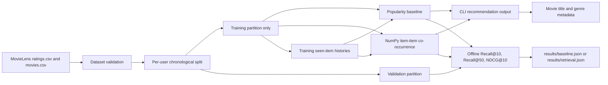

# Personalized Movie Recommendation Engine

This project is a leakage-safe offline movie recommendation demo using the
local MovieLens 25M dataset. It includes a popularity baseline and a sparse
NumPy item-item co-occurrence retrieval fallback. It does not claim to be a
production-scale Netflix- or Amazon-style platform.

The dataset is expected at `data/ml-25m/` and is intentionally excluded from
version control.

## Setup

Create the isolated environment on Windows:

```powershell
py -3.13 -m venv .venv
.\.venv\Scripts\python.exe -m pip install -r requirements.txt
```

The original dataset must already be present at `data/ml-25m/`. It is never
modified by these commands. The virtual environment, dataset, results, and
artifacts are excluded from version control.

The isolated environment currently contains the dependencies needed by the
validated pipeline and tests. Streamlit is not installed in this environment;
because package installation is intentionally out of scope for this handoff,
the supported demo surface is the reproducible CLI below.

## Architecture and data flow



The offline flow validates the original CSV files, performs a deterministic
per-user chronological split, fits recommendation statistics only on the
training partition, and evaluates against positive validation interactions.
The online-like demo loads the training-derived recommender, filters items
already seen by a known user, and joins original movie metadata before
printing recommendations.

The TensorFlow Recommenders two-tower model is a separate experimental
training and evaluation path. It is not part of the default NumPy-backed
recommendation API or local HTTP demo.

## Validation and tests

Validate the dataset:

```powershell
.\.venv\Scripts\python.exe scripts\validate_dataset.py
```

Expected local dataset counts are 25,000,095 ratings and 62,423 movies.

Run the complete test suite:

```powershell
.\.venv\Scripts\python.exe -m pytest
```

## Demo execution

Run the training-only popularity baseline and save its evaluation:

```powershell
.\.venv\Scripts\python.exe scripts\run_baseline.py
```

Generate five baseline recommendations for a known MovieLens user:

```powershell
.\.venv\Scripts\python.exe scripts\run_baseline.py --user-id 1 --k 5
```

The recommendation table includes the original `movieId`, `title`, and
`genres` columns. For known users, movies present in that user's chronological
training history are excluded. The command also recalculates the baseline
evaluation before printing recommendations, so it can take several minutes on
the full MovieLens 25M data.

Unknown users are handled by the popularity fallback because no personal
training history is available. The co-occurrence retriever uses the same
training-only popularity fallback when it has insufficient personalized
candidates.

## Local HTTP demo

The isolated environment does not currently contain Streamlit, FastAPI, or
Uvicorn, so no unverified dependency was added. A dependency-free local HTTP
demo is available and calls the actual baseline and NumPy retrieval service:

```powershell
.\.venv\Scripts\python.exe scripts\run_api.py
```

Then open or query:

```powershell
curl http://127.0.0.1:8000/health
curl "http://127.0.0.1:8000/recommendations/1?k=5&method=retrieval"
curl "http://127.0.0.1:8000/recommendations/999?k=5&method=baseline"
```

See [API documentation](docs/api.md) for endpoints and response behavior.
Startup loads the full local dataset and is intended for a local demonstration,
not production serving.

For a dependency-free browser demonstration backed by the same service:

```powershell
.\.venv\Scripts\python.exe scripts\run_demo_ui.py
```

Open `http://127.0.0.1:8501/`. The UI includes the recommendation workflow,
honest co-occurrence/popularity explanations, and a read-only Model Evaluation
section backed by saved artifacts. Optional OMDb posters can be enabled with
the server-side `OMDB_API_KEY` environment variable or a local `.env` file.
The application remains fully usable without it and renders
cached/offline placeholders instead.

Configure posters locally without committing the key:

```powershell
Copy-Item .env.example .env
# Edit .env and replace the placeholder with your OMDb key.
.\.venv\Scripts\python.exe scripts\run_demo_ui.py
```

The server reads MovieLens `links.csv` IMDb IDs and sends them to OMDb as
`tt...` identifiers. If no IMDb ID is available, it uses the normalized
MovieLens title and year. Poster URLs are cached under
`artifacts/posters/omdb_cache.json`; OMDb failures, missing posters, timeouts,
and rate limits fall back to the existing placeholder without affecting
recommendations. The API key is never sent to browser JavaScript.

Open `http://127.0.0.1:8501/`, enter a user ID, choose the retrieval method,
and set a recommendation count from 1 to 100.

Inspect available command options before changing parameters:

```powershell
.\.venv\Scripts\python.exe scripts\run_baseline.py --help
.\.venv\Scripts\python.exe scripts\run_retrieval.py --help
```

The learned TensorFlow Recommenders retriever has a separate bounded smoke
command. Do not omit the TensorFlow environment variables:

```powershell
$env:TF_USE_LEGACY_KERAS="1"
$env:PYTHONPATH="D:\recommendation\src"
.\.venv-tf312\Scripts\python.exe scripts\run_learned_retrieval.py `
  --ratings-row-limit 20000 --sample-size 5000 --dimension 8 `
  --batch-size 256 --epochs 1 --validation-user-limit 20 `
  --skip-dataset-validation
```

This smoke path saves compact mappings, item embeddings, model weights,
configuration, metadata, and sorted seen-item histories, then reloads the
artifacts before reporting metrics. The full MovieLens 25M learned run has not
been completed; its previous attempt was stopped during the large per-user
history serialization phase.

After aligning the baseline to the learned model's training-vocabulary
candidate universe, bounded 100,000-row experiments still showed lower learned
metrics. The best tested configuration (dimension 16, one epoch, 25,000
sampled positives, 100 validation users) achieved Recall@10 0.03311, Recall@50
0.12521, and NDCG@10 0.02361 versus the aligned popularity baseline's 0.08588,
0.16936, and 0.06312. These are diagnostic bounded results, not full-dataset
or statistically significant results. Full training remains deferred.

For a fair bounded comparison of all retrieval paths, use the shared harness.
It persists the seeded validation users and candidate universe and evaluates
all methods with identical relevance and seen-item rules:

```powershell
$env:TF_USE_LEGACY_KERAS="1"
$env:PYTHONPATH="D:\recommendation\src"
.\.venv-tf312\Scripts\python.exe scripts\run_shared_evaluation.py `
  --ratings-row-limit 250000 --sample-size 100000 --dimension 16 `
  --batch-size 512 --epochs 1 --validation-user-limit 100 --seed 42 `
  --skip-dataset-validation --output-dir results\shared_250k
```

The verified 250,000-row run took 22.979 seconds. NumPy co-occurrence
outperformed popularity and the two-tower model; the learned path remains
experimental and is not promoted to the default API.

The prefix-based sample is not representative of all MovieLens users because
the ratings file is grouped by user. The harness also supports a seeded
uniform-user strategy that streams complete histories for selected users
before applying the same chronological split. A verified 2,000-user sample
evaluated 1,000 users under seeds 42, 43, and 44 in 924.313 seconds. NumPy
co-occurrence remained first, popularity second, and TFRS third for every
seed. This remains bounded diagnostic evidence; peak memory was not measured.

## Evaluation

The baseline treats ratings greater than or equal to `4.0` as positive
interactions. Popularity counts, tie-breaking rating means, and seen-item
filtering are fitted from the chronological training partition only. Validation
is used only to calculate macro-averaged Recall@10, Recall@50, and NDCG@10.

Run the NumPy retrieval smoke evaluation (1,000 validation users):

```powershell
.\.venv\Scripts\python.exe scripts\run_retrieval.py
```

Run retrieval evaluation for the complete validation population only when the
long runtime is acceptable:

```powershell
.\.venv\Scripts\python.exe scripts\run_retrieval.py --validation-user-limit 0
```

`results/baseline.json` contains the measured baseline metrics for 150,363
validation users. The saved retrieval result currently contains a 1,000-user
smoke evaluation; its metrics must not be presented as full-validation
results. Retrieval metrics use positive validation ratings (`>= 4.0`) and are
macro-averaged over users with at least one positive validation interaction.

The reported metric denominator is the number of validation users with at
least one positive validation interaction. Recall@K is the fraction of that
user's relevant positive validation movies found in the first K results,
averaged across users. NDCG@10 additionally discounts lower-ranked hits.
Newly generated shared evaluation artifacts distinguish users considered
(unique validation users before eligibility filtering), users with eligible positive
validation items in the candidate catalog, and users actually evaluated after
the configured sample limit. Existing artifacts retain their original schema.

## Current limitations

- The default retrieval demo is a sparse NumPy item-item co-occurrence
  fallback; the learned TensorFlow Recommenders two-tower path is a separate
  CPU-only experiment.
- TensorFlow/TFRS native runtime initialization was unstable on Windows Python
  3.13, so the runnable demo does not use it.
- A learned candidate-ranking stage has not been implemented. The popularity
  baseline is an evaluation baseline, not a DCN or Wide & Deep ranker.
- The TensorFlow Recommenders path is validated only on bounded smoke data in
  `.venv-tf312`; no full MovieLens 25M TensorFlow metrics are claimed.
- Spark preprocessing, FAISS indexing, a deep ranking model, Redis caching,
  Airflow orchestration, Triton serving, and production deployment are not
  implemented.
- Streamlit is not installed or validated in the current environment; use the
  CLI demo commands above rather than claiming a Streamlit application.
- The MovieLens ratings are explicit ratings, not click-through or conversion
  events; the reported metrics are offline validation metrics only.
- The implementation is a functional CPU demo and is not production-scale
  readiness or a claim of production latency.

See [model training status](docs/model_training.md) for the exact TensorFlow
diagnostic and the separate-environment requirements.

## Submission materials

- [Presentation outline](docs/presentation_outline.md) contains a concise
  10-minute walkthrough with actual results and limitations.
- [Project reflection](docs/project_reflection.md) summarizes the individual
  engineering decisions, trade-offs, and remaining work.
- [Implementation status](docs/implementation_status.md) distinguishes tested
  components from unavailable or unimplemented infrastructure.
